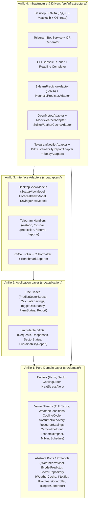

# 🐄 AgroPredictTambo — Sistema Predictivo de Estrés Térmico y Refrigeración Sectorizada

[](https://github.com/DiveShower/AgroPredictTambo)
[](steering.md)
[](tests/test_architecture.py)
[](tests/)
[](requirements.txt)

Software industrial de **Predicción Bioclimática por Machine Learning, Control Sanitario Anti-Mastitis y Eficiencia Hídrica/Energética ESG** para establecimientos lecheros, desarrollado para el desafío **Nestlé Conecta — AgroChallenge 2026** (*Caso Piloto: Tambo San José, Rafaela, Santa Fe, Argentina*).

* 📄 **Especificación Técnica Maestra (SSOT):** [spec.md](spec.md)
* 🎤 **Guion del Pitch para el Jurado (180s):** [PITCH_NESTLE_2026.md](PITCH_NESTLE_2026.md)
* 🧭 **Reglas de Ingeniería y Gobernanza AST:** [steering.md](steering.md)
* 🔬 **Spikes de Arquitectura e Investigación Aplicada:** [docs/spikes/](docs/spikes/)

---

## 📌 1. ¿Qué hace el sistema y qué problema resuelve?

En la cuenca lechera central de Argentina, el **estrés calórico bovino** ($\text{ITH} \ge 68\text{–}72$) provoca caídas abruptas de **$3\text{ a }5\text{ litros de leche/vaca/día}$**, inmunosupresión y caída de la tasa de concepción. Los sistemas tradicionales de enfriamiento operan mediante **temporizadores ciegos de 8 horas continuas (10:00 a 18:00 hs)** con boquillas de alto caudal ($4.9\text{ L/min}$), lo que genera:
1. **Derroche masivo de agua subterránea y energía eléctrica** al regar corrales vacíos o en horarios sin carga térmica crítica.
2. **Riesgo sanitario de mastitis ambiental** al humedecer camas orgánicas (*Compost Barn*) por falta de sectorización inteligente.
3. **Reacción tardía**, cuando el animal ya acumuló inercia calórica y elevó su frecuencia respiratoria ($> 60\text{ mov/min}$).

### 🚀 Innovaciones Clave de AgroPredictTambo
* **Inferencia Predictiva ML (+1h / +2h) sin Data Leakage:** Clasificador `RandomForestClassifier` entrenado sobre **8 variables bioclimáticas** (Temperatura, Humedad Relativa, Velocidad de Viento, Radiación Solar de Onda Corta $\text{W/m}^2$, Hora del Día, Depresión de Bulbo Húmedo de Stull, Inercia Térmica Móvil de $3\text{ h}$ y Deuda Térmica Nocturna), logrando **$95.83\%$ de Accuracy** y **$100\%$ de Recall en clase Peligro** frente al $85.71\%$ del ITH estático.
* **Sectorización Activa y Regla Sanitaria Anti-Mastitis:**
  * **Sectores de Hormigón (`corral_espera`, `comederos`):** Ejecutan micro-ciclos evaporativos INTA Rafaela / *Chen et al. (2016)* con boquillas eficientes de **$1.3\text{ L/min}$** ($40\text{s}$ de mojado + $270\text{s}$ de ventilación forzada en Nivel 2; solo ventilación en Nivel 1).
  * **Cama Orgánica (`sombras` / Compost Barn):** Aplica bloqueo sanitario estricto (`allows_water_sprinkling = False` $\rightarrow$ **$0\text{s}$ de agua**) activando únicamente ventilación convectiva ($270\text{s}$) incluso con $\text{ITH} > 80$ para prevenir barro y mastitis.
  * **Corte por Desocupación (`current_occupancy = False`):** Si el rodeo abandona un sector, el sistema cancela el $100\%$ del enfriamiento en esa zona.
* **Deuda Térmica Nocturna y Pre-enfriamiento de Ordeñe:** Evalúa el descanso nocturno previo ($21:00\text{ a }06:00\text{ hs}$); si el rodeo tuvo menos de $6\text{ horas}$ con $\text{ITH} < 65.0$, reduce automáticamente los umbrales diurnos hasta **$-3.0\text{ puntos de ITH}$**. Además, dispara pre-enfriamiento preventivo $15\text{ minutos}$ antes de los turnos de ordeñe (`04:30` y `16:00`).
* **Resiliencia Rural Offline-First & Watchdog Físico de 60s:** Ante cortes de internet rural, conmuta transparentemente a la caché local SQLite (`SqliteWeatherCacheAdapter`) y al predictor heurístico determinístico (`HeuristicPredictorAdapter`). Los controladores de relés imponen un límite *Watchdog* de máximo $60\text{ segundos}$ continuos de válvula de agua.

---

## 🛠️ 2. Stack Tecnológico

| Capa / Dominio | Tecnologías y Librerías | Propósito en el Proyecto |
| :--- | :--- | :--- |
| **Lenguaje & Tipado** | `Python 3.10–3.14`, `typing`, `Pyright` | Núcleo tipado con `Protocol` (PEP 544) y `dataclass(frozen=True)`. |
| **Machine Learning & Datos** | `scikit-learn`, `pandas`, `numpy`, `joblib` | Pipeline `RandomForestClassifier`, vectorización sin *leakage* y caché LRU. |
| **Ingesta Climática & Red** | `requests`, `urllib3` (Retry/Backoff), `Open-Meteo API` | Consulta meteorológica actual y pronóstico horario con radiación solar. |
| **Persistencia Offline** | `sqlite3` (`auto_vacuum = INCREMENTAL`) | Caché climática local con validación de TTL (`6 horas`) para operación sin red. |
| **Estación SCADA Desktop** | `PyQt6`, `matplotlib` (`FigureCanvasQTAgg`), `QSS` | Interfaz industrial oscura de 5 pestañas a 60 fps con `QThread` y `QTimer` maestro. |
| **Canal Móvil & QR** | `python-telegram-bot`, `qrcode[pil]`, REST HTTP | Bot interactivo bidireccional sincronizado con el SCADA y alertas push síncronas. |
| **Reportes ESG & Auditoría** | `fpdf2`, `DejaVuSans.ttf` (Unicode UTF-8) | Generación asíncrona de reportes PDF con logotipo Nestlé Conecta, CAMMESA y SIGLeA. |
| **Hardware IoT** | `pyserial` (`SerialRelayAdapter`, `MockRelayAdapter`) | Actuación sobre electroválvulas y ventiladores por USB/Arduino con Watchdog de 60s. |
| **Calidad & Testing** | `pytest`, `pytest-mock`, `ast`, `ruff` | Suite de **133 tests** (unitarios, integración, E2E y guantelete arquitectónico AST). |

---

## 🏛️ 3. Arquitectura Limpia en 4 Anillos (Clean Architecture)

El sistema implementa una separación concéntrica estricta en **4 Anillos** auditada automáticamente en cada corrida de tests por [tests/test_architecture.py](tests/test_architecture.py):



### 📏 Reglas Estructurales Inquebrantables ([steering.md](steering.md))
1. **Regla Ultra-Atómica ($\le 60$ líneas):** Ningún archivo `.py` o `.qss` en `src/`, `tests/` o `data/scripts/` supera las **60 líneas físicas**. Cada concepto reside en su propio módulo atómico.
2. **Inversión de Dependencias Pura:**
   * `src/domain/` no importa **ninguna** librería externa ni módulos de otros anillos.
   * `src/application/` solo importa de `src/domain/` y la biblioteca estándar de Python.
   * `src/adapters/` solo importa de `src/application/` y `src/domain/` (cero referencias a `PyQt6`, `telegram`, `sklearn`, `matplotlib` o `sqlite3`).
3. **Paquetes Limpios:** Todos los archivos `__init__.py` bajo `src/` y `tests/` miden exactamente **0 bytes**.

---

## 📂 4. Árbol de Archivos del Proyecto

```text
AgroPredictTambo/
├── README.md                                  # Documentación general y guía de operación
├── spec.md                                    # Especificación Técnica Maestra (v2.3.0)
├── steering.md                                # Reglas de gobernanza arquitectónica y cota de 60 líneas
├── PITCH_NESTLE_2026.md                       # Guion audiovisual de 3 minutos y métricas para el jurado
├── requirements.txt                           # Dependencias del proyecto compatibles con Linux
├── pytest.ini                                 # Configuración de Pytest y markers oficiales
├── pyrightconfig.json                         # Configuración de chequeo estático de tipos
├── .env.example                               # Plantilla de variables de entorno del tambo
│
├── src/                                       # CÓDIGO FUENTE (CLEAN ARCHITECTURE - 4 ANILLOS)
│   ├── main.py                                # Composition Root único (--desktop, --bot, --cli, --benchmark)
│   │
│   ├── domain/                                # 🟢 ANILLO 1: DOMINIO PURO (Cero dependencias externas)
│   │   ├── entities/
│   │   │   ├── farm.py                        # Entidad raíz del establecimiento lechero
│   │   │   ├── sector.py                      # Sector físico, umbrales y regla anti-mastitis
│   │   │   ├── cooling_order.py               # Orden de activación (agua y ventilación en segundos)
│   │   │   └── heat_stress_alert.py           # Alerta preventiva de estrés calórico
│   │   ├── value_objects/
│   │   │   ├── weather_conditions.py          # Variables meteorológicas y depresión de bulbo húmedo (Stull)
│   │   │   ├── thi_score.py                   # Cálculo NRC/Thom de ITH e inercia móvil de 3h
│   │   │   ├── cooling_cycle.py               # Micro-ciclo evaporativo (1.3 L/min, 40s agua / 270s vent.)
│   │   │   ├── nocturnal_recovery.py          # Deuda térmica nocturna y penalización de umbral (-3.0 pts)
│   │   │   ├── milking_schedule.py            # Agenda de ordeñe y ventana de pre-enfriamiento (15 min)
│   │   │   ├── resource_savings.py            # Matemática de ahorro hídrico (software + boquilla) y kWh
│   │   │   ├── carbon_footprint.py            # Huella de carbono evitada (Factor CAMMESA 0.35 kg CO2e/kWh)
│   │   │   └── economic_impact.py             # Leche defendida y retorno en ARS (Panel SIGLeA)
│   │   ├── ports/
│   │   │   ├── weather_provider_port.py       # Protocolo IWeatherProvider
│   │   │   ├── weather_cache_port.py          # Protocolo IWeatherCache
│   │   │   ├── model_predictor_port.py        # Protocolo IModelPredictor
│   │   │   ├── sector_repository_port.py      # Protocolo ISectorRepository
│   │   │   ├── notifier_port.py               # Protocolo INotifier
│   │   │   ├── hardware_controller_port.py    # Protocolo IHardwareController
│   │   │   └── report_generator_port.py       # Protocolo IReportGenerator
│   │   ├── exceptions/
│   │   │   ├── base_domain_exception.py       # Excepción base del dominio
│   │   │   ├── invalid_weather_exception.py   # Excepción por rango físico inválido
│   │   │   └── sector_not_found_exception.py  # Excepción por sector inexistente
│   │   └── fixtures/
│   │       └── default_farm.py                # Datos semilla de Tambo San José (3 sectores)
│   │
│   ├── application/                           # 🔵 ANILLO 2: CAPA DE APLICACIÓN (Casos de Uso y DTOs)
│   │   ├── dtos/
│   │   │   ├── predict_stress_request_dto.py
│   │   │   ├── predict_stress_response_dto.py
│   │   │   ├── calculate_savings_request_dto.py
│   │   │   ├── calculate_savings_response_dto.py
│   │   │   ├── sector_status_dto.py
│   │   │   ├── stress_actuation_context.py
│   │   │   └── sustainability_report_dto.py
│   │   └── use_cases/
│   │       ├── predict_sector_stress_uc.py    # Orquestador principal de predicción y órdenes
│   │       ├── stress_pipeline_runner.py      # Ejecutor del pipeline bioclimático por sector
│   │       ├── sector_order_helper.py         # Evaluador de ciclo, anti-mastitis y alertas
│   │       ├── weather_fetcher_helper.py      # Resolución de clima con failover a caché SQLite
│   │       ├── nocturnal_recovery_helper.py   # Cómputo de horas frescas nocturnas
│   │       ├── calculate_savings_uc.py        # Cálculo comparativo 8h fijo vs predictivo
│   │       ├── toggle_sector_occupancy_uc.py  # Conmutación atómica de presencia animal
│   │       ├── get_farm_status_uc.py          # Estado consolidado del tambo en tiempo real
│   │       └── generate_sustainability_report_uc.py # Orquestador del informe ESG PDF
│   │
│   ├── adapters/                              # 🟡 ANILLO 3: ADAPTADORES DE INTERFAZ (Presenters / Handlers)
│   │   ├── desktop/viewmodels/
│   │   │   ├── scada_viewmodel.py             # ViewModel del tablero SCADA y emergencia
│   │   │   ├── forecast_viewmodel.py          # ViewModel de curva ITH 24h y simulador jurado
│   │   │   └── savings_viewmodel.py           # ViewModel de KPIs financieros/ESG y exportación PDF
│   │   ├── telegram/
│   │   │   ├── handlers/                      # Handlers atómicos (/start, /estado, /pronostico, /sectores,
│   │   │   │   └── ...                        # /ocupar, /prediccion, /ahorro, /reporte)
│   │   │   └── formatters/
│   │   │       ├── message_formatter.py       # Tablas monoespaciadas y alertas para móvil
│   │   │       └── sector_and_savings_formatter.py
│   │   └── cli/
│   │       ├── cli_controller.py              # Controlador de comandos en terminal
│   │       ├── cli_formatter.py               # Formateador tabular ASCII
│   │       └── benchmark_exporter.py          # Exportador JSON de telemetría 24h (--export-json)
│   │
│   └── infrastructure/                        # 🔴 ANILLO 4: INFRAESTRUCTURA Y DRIVERS TÉCNICOS
│       ├── ioc_container.py                   # Contenedor IoC de dependencias compartidas
│       ├── ioc_weather_resolver.py            # Selector dinámico de proveedor climático
│       ├── use_case_factory.py                # Fábrica de ensamblaje del núcleo
│       ├── weather_api/
│       │   ├── open_meteo_adapter.py          # Cliente REST Open-Meteo (actual + 24h)
│       │   ├── http_retry_client.py           # Sesión HTTP con Retry exponencial
│       │   ├── mock_weather_adapter.py        # Perfiles determinísticos (heatwave, nocturnal_debt, temperate)
│       │   └── weather_api_mapper.py          # Mapeador JSON -> WeatherConditions
│       ├── ml/
│       │   ├── sklearn_predictor_adapter.py   # Inferencia Random Forest (.joblib comprimido zlib)
│       │   ├── heuristic_predictor_adapter.py # Fail-safe bioclimático determinístico
│       │   ├── inference_lru_cache.py         # Caché LRU en memoria por firma bioclimática
│       │   ├── feature_builder.py             # Constructor de las 8 features sin data leakage
│       │   ├── model_evaluator.py             # Evaluador contra baseline DecisionTree e ITH estático
│       │   ├── train_pipeline.py              # Pipeline de entrenamiento temporal 80/20
│       │   └── artifacts/                     # Modelo entrenado (.joblib) y training_report.json
│       ├── persistence/
│       │   ├── sqlite_weather_cache_adapter.py# Caché offline SQLite con TTL y auto-vacuum
│       │   └── cache_schema.py                # DDL y consultas SQL parametrizadas
│       ├── repositories/
│       │   └── in_memory_sector_repo.py       # Repositorio de sectores thread-safe (RLock)
│       ├── notifications/
│       │   └── telegram_notifier_adapter.py   # Emisor HTTP POST síncrono de alertas push
│       ├── hardware/
│       │   ├── serial_relay_adapter.py        # Driver serie USB/Arduino con Watchdog de 60s
│       │   └── mock_relay_adapter.py          # Simulador de relés en memoria con Watchdog de 60s
│       ├── reporting/
│       │   ├── pdf_sustainability_report_adapter.py # Renderizador PDF ESG con fpdf2
│       │   ├── pdf_asset_loader.py            # Cargador de fuente Unicode DejaVuSans y logo Nestlé
│       │   ├── pdf_water_section.py           # Sección de balance hídrico del PDF
│       │   ├── pdf_energy_section.py          # Sección energética y huella CAMMESA del PDF
│       │   └── assets/                        # Fuente DejaVuSans.ttf y nestle_conecta_logo.png
│       └── ui/
│           ├── desktop/                       # Estación Base Nativa PyQt6
│           │   ├── app.py                     # Inicializador QApplication y carga de tema QSS
│           │   ├── main_window.py             # Ventana principal con sincronización QThread
│           │   ├── tab_builder.py             # Constructor de las 5 pestañas operativas
│           │   ├── styles/dark_agro_theme.qss # Tema industrial oscuro con propiedades dinámicas
│           │   ├── workers/                   # WeatherSyncWorker, TelegramBotWorker, PdfExportWorker
│           │   ├── components/                # SectorCardWidget, ThiGaugeWidget, ForecastChartWidget, etc.
│           │   └── views/                     # ScadaView, ForecastView, SavingsView, SimulationView, ReportView
│           ├── telegram_bot/
│           │   ├── bot_service.py             # Servicio python-telegram-bot con modo fail-safe
│           │   ├── bot_command_router.py      # Enrutador de comandos móviles
│           │   └── qr_generator.py            # Generador automático de data/cache/bot_qr.png
│           └── cli/
│               ├── console_runner.py          # Menú interactivo de consola y runner benchmark
│               └── readline_completer.py      # Autocompletado con Tab de sectores en terminal
│
├── data/                                      # DATOS, CACHÉ LOCAL Y SCRIPTS DE INGENIERÍA DE DATOS
│   ├── scripts/                               # Scripts atómicos de extracción Open-Meteo y dataset sintético
│   ├── processed/weather_heat_stress_dataset.csv # Dataset horario etiquetado (2520 observaciones)
│   └── cache/                                 # SQLite cache, código QR (bot_qr.png) y reportes PDF
│
├── docs/spikes/                               # DOCUMENTACIÓN DE SPIKES ARQUITECTÓNICOS (#16 a #21)
│   ├── spike_16_serial_watchdog.md            # Protocolo serie y circuito Watchdog físico de 60s
│   ├── spike_17_microclimate_sensors.md       # Fusión híbrida de sensores in-situ y Open-Meteo
│   ├── spike_18_siglea_cammesa_automation.md  # Automatización de parámetros SIGLeA y CAMMESA
│   ├── spike_19_automatic_occupancy_detection.md # Detección automática de ocupación en corrales
│   ├── spike_20_linux_packaging_systemd.md    # Empaquetado autónomo Linux y servicio systemd
│   └── spike_21_telegram_bot_security.md      # Seguridad RBAC y whitelist del Bot de Telegram
│
└── tests/                                     # SUITE AUTOMATIZADA DE PRUEBAS (133 TESTS)
    ├── test_architecture.py                   # Guantelete AST (4 anillos, 0-byte __init__, <= 60 líneas)
    ├── test_domain/                           # Tests unitarios puros de fórmulas, entidades y reglas
    ├── test_application/                      # Tests de casos de uso con mocks de puertos
    ├── test_adapters/                         # Tests de ViewModels, CliController y Handlers de Telegram
    ├── test_infrastructure/                   # Tests de integración (ML, SQLite, Open-Meteo, PDF, QR, Qt)
    └── test_e2e/                              # Tests End-to-End de flujos completos del sistema
```

---

## ⚙️ 5. Instalación y Configuración

### 1. Clonar el repositorio y crear el entorno virtual en Linux
```bash
git clone https://github.com/DiveShower/AgroPredictTambo.git
cd AgroPredictTambo
python3 -m venv .venv
source .venv/bin/activate
pip install --upgrade pip
pip install -r requirements.txt
```

### 2. Configurar variables de entorno (`.env`)
```bash
cp .env.example .env
```
Parámetros principales en `.env`:
* `FARM_NAME="Tambo San José - Nestlé Conecta"`
* `FARM_LATITUDE=-31.25` / `FARM_LONGITUDE=-61.48` (Rafaela, Santa Fe)
* `DEFAULT_COW_COUNT=100` / `MILK_PRICE_ARS_PER_LITER=430.0` (Referencia SIGLeA)
* `WEATHER_PROVIDER="open_meteo"` (`open_meteo` | `mock`)
* `TELEGRAM_BOT_TOKEN=""` y `TELEGRAM_ADMIN_CHAT_ID=""` *(Opcional: si se deja vacío, la app de escritorio y la CLI operan normalmente en modo fail-safe)*

---

## 🚀 6. Guía de Uso — Los 3 Niveles de MVP

El punto de entrada único [src/main.py](src/main.py) permite levantar cualquiera de las interfaces compartiendo exactamente el mismo motor de dominio y casos de uso:

### 🖥️ MVP Nivel 3: Estación Base SCADA Nativa (PyQt6)
```bash
# Iniciar Estación SCADA con perfil de demostración de Ola de Calor
python src/main.py --desktop --demo-heatwave

# Iniciar Estación SCADA conectada al clima en tiempo real (Open-Meteo Rafaela)
python src/main.py --desktop
```
**Pestañas disponibles en la estación SCADA:**
1. **TAB 1 — SCADA TAMBO:** Cuadrante general de ITH, tarjetas reactivas de los 3 sectores (`corral_espera`, `comederos`, `sombras`), switches de ocupación animal en vivo, bloqueo sanitario anti-mastitis en Compost Barn, cronómetro regresivo `40s / 270s` y barra inferior con botones **"Sincronizar Clima Ahora"**, **"Simular Ola de Calor"** y **"Detención de Emergencia"**.
2. **TAB 2 — CURVA ITH 24H:** Gráfico `matplotlib` con blitting incremental, líneas de umbral ajustadas por deuda térmica nocturna y marcadores de pre-enfriamiento ML.
3. **TAB 3 — ROI & ESG:** Tarjetas KPI de agua ahorrada (software y combinada), energía eléctrica ($\text{kWh}$), huella de carbono CAMMESA ($\text{kg CO}_2\text{e}$) y leche defendida SIGLeA ($\text{ARS}$).
4. **TAB 4 — SIMULADOR JURADO:** 4 sliders interactivos con *debounce* (Temperatura $15\text{–}45\text{°C}$, Humedad $20\text{–}95\%$, Viento $0\text{–}40\text{ km/h}$, Radiación Solar $0\text{–}1000\text{ W/m}^2$) que recalculan en vivo la respuesta en pisos de hormigón vs cama de compost.
5. **TAB 5 — REPORTE PDF:** Previsualización ejecutiva y exportación asíncrona (`QThreadPool`) del reporte PDF auditado con apertura automática en el visor del sistema.

---

### 📱 MVP Nivel 2: Bot de Telegram Interactivo y Código QR
```bash
# Iniciar el Bot de Telegram en modo standalone y generar data/cache/bot_qr.png
python src/main.py --bot --demo-heatwave
```
Comandos disponibles para el productor o el jurado desde su celular:
* `/start` o `/help` — Menú interactivo de comandos.
* `/estado` — Condiciones meteorológicas actuales e ITH en Rafaela.
* `/pronostico` — Proyección horaria de ITH a 24 horas.
* `/sectores` — Estado de ocupación, piso y equipamiento de los 3 sectores.
* `/ocupar <sector_id> <true/false>` — Simula el ingreso/egreso de vacas en vivo (ej. `/ocupar corral_espera false`) y actualiza instantáneamente la pantalla SCADA de escritorio.
* `/prediccion` — Ejecuta la inferencia ML a $+1\text{h}$ y detalla las órdenes de enfriamiento por sector.
* `/ahorro` — Balance auditado de litros de agua, $\text{kWh}$, $\text{CO}_2\text{e}$ y leche protegida.
* `/reporte` — Genera y envía el PDF de sustentabilidad directamente al chat de Telegram.

---

### ⌨️ MVP Nivel 1: Consola Interactiva (CLI) y Modo Benchmark 24h
```bash
# Ejecutar simulación analítica completa de 24 horas en terminal
python src/main.py --cli --benchmark

# Exportar telemetría del benchmark 24h a un archivo JSON auditable
python src/main.py --cli --benchmark --export-json data/cache/benchmark_24h.json

# Abrir menú interactivo de diagnóstico en consola (con autocompletado Tab)
python src/main.py --cli --demo-heatwave
```

---

## 📊 7. Impacto Auditado de Sustentabilidad ESG y Retorno Productivo

Resultados verificados en el benchmark de 24 horas para el caso piloto (**100 vacas en ordeñe**, operación predictiva focalizada de $3.5\text{ h}$ frente al régimen tradicional continuo de $8.0\text{ h}$):

| Indicador Auditado | Régimen Tradicional (8h Fijas) | Sistema Predictivo AgroPredictTambo | Impacto Neto Verificado |
| :--- | :---: | :---: | :--- |
| **Consumo de Agua (Software, pico `1.3 L/min`)** | $2\,012.90\text{ L/día}$ | $880.65\text{ L/día}$ | **$1\,132.26\text{ L/día}$ ahorrados ($56.25\%$)** |
| **Consumo Hidráulico Tradicional (pico `4.9 L/min`)** | $7\,587.10\text{ L/día}$ | $880.65\text{ L/día}$ | **$6\,706.45\text{ L/día}$ ahorrados ($88.39\%$)** |
| **Consumo de Energía Eléctrica (Bomba + Vent.)** | $86.27\text{ kWh/día}$ | $37.74\text{ kWh/día}$ | **$48.53\text{ kWh/día}$ ahorrados ($56.25\%$)** |
| **Huella de Carbono Evitada (Factor CAMMESA)** | — | Factor $0.35\text{ kg CO}_2\text{e/kWh}$ | **$16.99\text{ kg CO}_2\text{e/día}$ evitados** |
| **Producción Láctea Defendida (Panel SIGLeA)** | Pérdida por estrés | Mitigación anticipada ML | **$80.00\text{ L/día}$ protegidos ($34\,400\text{ ARS/día}$)** |

---

## 🧪 8. Suite de Pruebas Automatizadas y Auditoría de Calidad

El repositorio cuenta con **133 pruebas automatizadas** divididas en `unit`, `architecture`, `integration` y `e2e`:

```bash
# Ejecutar las 133 pruebas (modo headless offscreen para PyQt6)
QT_QPA_PLATFORM=offscreen .venv/bin/pytest -v

# Ejecutar únicamente el guantelete AST de Clean Architecture y límite de 60 líneas
.venv/bin/python tests/test_architecture.py

# Ejecutar únicamente las pruebas integrales End-to-End (E2E)
QT_QPA_PLATFORM=offscreen .venv/bin/pytest -m e2e -v

# Re-entrenar y auditar el modelo Random Forest sin data leakage
.venv/bin/python src/infrastructure/ml/train_pipeline.py
```

---

## 📚 9. Respaldo Científico y Bibliografía

1. **Oliveira, C. P., et al. (2025).** *Heat Stress in Dairy Cows: Impacts, Identification, and Mitigation Strategies—A Review*. Animals, 15(2), 249. https://doi.org/10.3390/ani15020249
2. **Chen, J. M., Schütz, K. E., & Tucker, C. B. (2016).** *Cooling cows in the feeding alley: Different sprinkler flow rates*. Journal of Dairy Science, 99(8), 6470–6481. *(Demostración experimental de que $1.3\text{ L/min}$ logra igual abatimiento térmico que $4.9\text{ L/min}$ reduciendo un $73.5\%$ el uso de agua).*
3. **Becker, C. A., et al. (2021).** *Evaluation of heat stress in dairy cows using machine learning algorithms*. Biosystems Engineering, 208, 105–115.
4. **Pacheco, P. R. V., et al. (2020).** *Machine learning models applied to the identification of heat stress in Holstein cows*. Computers and Electronics in Agriculture, 178, 105760.
5. **Taverna, M., et al. (2018).** *Pautas técnicas para el manejo del estrés calórico en rodeos lecheros*. INTA EEA Rafaela.

---

## 👥 Autores — Equipo AgroChallenge 2026 (Nestlé Conecta)

* **Iván Pereyra** ([@jpereyra89](https://github.com/jpereyra89))
* **Facundo León** ([@DiveShower](https://github.com/DiveShower))
