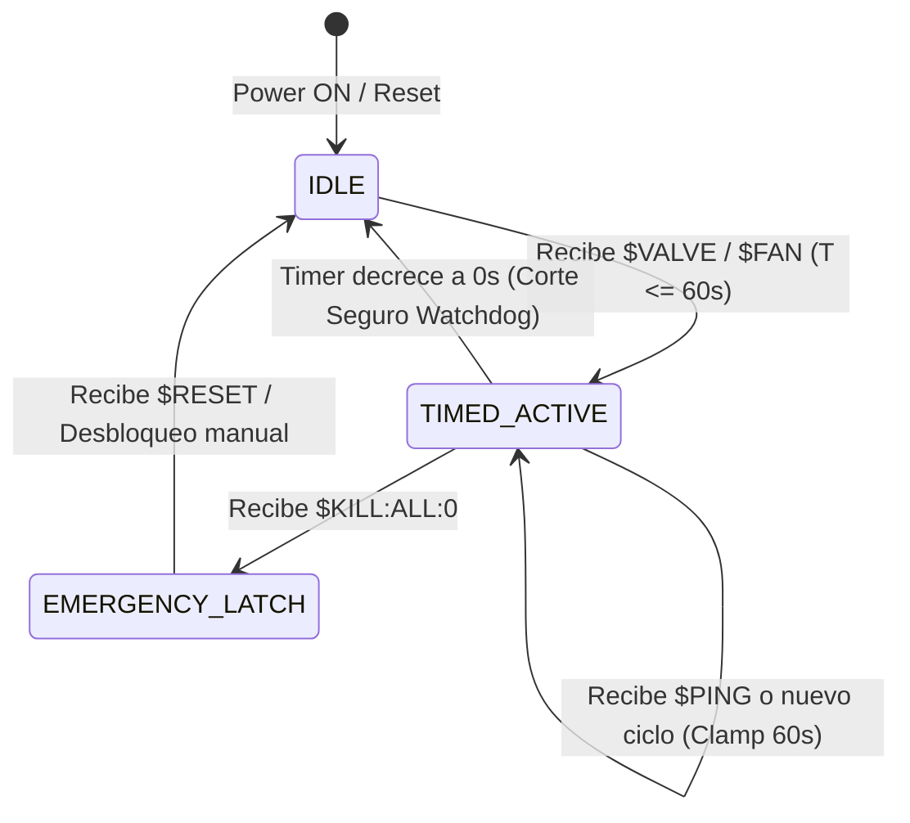

# SPIKE #16: Protocolo Serie (pyserial) y Circuito Watchdog Físico de 60s para Control Seguro de Relés

**Estado:** Completado / Aprobado  
**Fecha:** Noviembre 2026  
**Proyecto:** AgroPredictTambo (Nestlé Conecta — AgroChallenge 2026)  
**Autor:** Subagente Arquitecto / Hardware Specialist  

---

## 1. Contexto & Justificación Operativa
En la operación lechera intensiva, el enfriamiento por micro-aspersión en comederos y corral de espera opera con caudales de agua significativos (1.3 a 4.9 L/min por pico) y presiones de línea de 2.5 a 4 bar.
Si la computadora central de la sala de ordeñe sufre un reinicio intempestivo, corte de alimentación, cuelgue del sistema operativo (kernel panic) o desconexión del cable USB mientras una electroválvula está abierta:
- Se generaría barro excesivo en pisos de cemento/compost barn.
- Se desperdiciarían miles de litros de agua potable.
- Se incrementaría el riesgo de mastitis ambiental o resbalones en el ganado.

Por tal motivo, el software **nunca debe asumir control en estado permanente sin supervisión**. Toda activación física debe estar gobernada por un **Watchdog físico de 60 segundos con corte automático por hardware/firmware**.

---

## 2. Especificación del Protocolo de Tramas Serie

### 2.1 Parámetros de Enlace
- **Puerto físico:** `/dev/agro_relay` (enlace simbólico udev persistente) o `/dev/ttyUSB0`
- **Baud Rate:** `115200 bps`
- **Formato:** `8N1` (8 bits de datos, sin paridad, 1 bit de parada)
- **Control de flujo:** Ninguno (software raw)
- **Timeout de lectura:** `500 ms`

### 2.2 Formato de Trama (ASCII con Checksum XOR)
La comunicación PC $\to$ Microcontrolador utiliza tramas delimitadas por `$` (inicio) y `\n` (fin):
```text
$<COMANDO>:<SECTOR>:<VALOR>*<CHECKSUM_HEX>\n
```

- `<COMANDO>`:
  - `VALVE`: Activación de válvula de aspersión.
  - `FAN`: Activación de ventilador de caudal.
  - `KILL`: Parada de emergencia inmediata (todos los relés OFF).
  - `PING`: Latido keep-alive para refrescar el temporizador.
- `<SECTOR>`: Identificador alfanumérico (`comederos`, `corral_espera`, `sombras`, o `ALL`).
- `<VALOR>`: Tiempo de activación en segundos (entero, rango permitido `[0..60]`). Si se solicita un valor $>60$, el firmware lo trunca a 60.
- `<CHECKSUM_HEX>`: Representación hexadecimal de 2 caracteres del XOR de todos los caracteres entre `$` y `*`.

#### Ejemplos de Tramas Válidas:
```text
$VALVE:comederos:40*3A\n
$FAN:sombras:60*2F\n
$KILL:ALL:0*18\n
$PING:KEEPALIVE:0*0C\n
```

### 2.3 Respuestas del Microcontrolador (ACK / NACK)
```text
!ACK:<COMANDO>:<SECTOR>\n
!NACK:<CODIGO_ERROR>\n
```
Códigos de error:
- `ERR_CRC`: Checksum inválido.
- `ERR_FMT`: Formato de trama corrupto.
- `ERR_MAX`: Tiempo excedió el tope de seguridad (clamp a 60s).
- `ERR_WD`: Activación rechazada por bloqueo de Watchdog.

### 2.4 Regla udev Persistente para Linux
Para evitar que el puerto cambie entre `/dev/ttyUSB0` y `/dev/ttyUSB1` tras reconexiones en Linux, se especifica la siguiente regla udev en `/etc/udev/rules.d/99-agropredict-relay.rules`:
```udev
# Módulo relé USB CH340 / CP2102
SUBSYSTEM=="tty", ATTRS{idVendor}=="10c4", ATTRS{idProduct}=="ea60", SYMLINK+="agro_relay", MODE="0666", GROUP="dialout"
```

---

## 3. Esquema Eléctrico y Fail-Safe Físico

```
   [ PC Linux ]
       │ (USB)
   ┌───▼─────────────────────────────────────────────────┐
   │ Microcontrolador (ESP32 / Arduino / PLC Modbus)     │
   │                                                     │
   │  PIN GPIO Relé ──[ 1kΩ ]──┐                         │
   │                           │                         │
   │                         ┌─┴─┐ Optoacoplador         │
   │                         │   │ PC817                 │
   │                         └─┬─┘                       │
   └───────────────────────────┼─────────────────────────┘
                               │
                       +12V/24V│ (Alimentación Bobina Externa)
                               ▼
                        ┌──────────────┐
                        │ Bobina Relé  │◄───[ Diodo Flyback 1N4007 ]
                        └──────┬───────┘
                               │
                      Transistor NPN (2N2222)
                               │
                              GND

   Circuito de Potencia:
   Fase (220VAC / 24VAC) ──[ Relé Pin COM ]
                           [ Relé Pin NA  ] ───► Electroválvula / Contactor Bomba
                           [ Relé Pin NC  ] ───► Desconectado (Flotante)
```

### Principio Fail-Safe:
1. **Configuración Normalmente Abierto (NA):** Si la bobina del relé se desenergiza por cualquier motivo (caída de tensión, reinicio de MCU, desconexión de alimentación), los contactos mecánicos se abren por la fuerza del resorte interno.
2. **Pull-Down en base de conmutación:** El pin de control del microcontrolador tiene una resistencia de `10 kΩ` a GND. Durante el estado de arranque o reset del microcontrolador (pines en alta impedancia Hi-Z), el transistor permanece en corte (`OFF`), garantizando cero flujo de agua.
3. **Aislamiento Galvánico:** Mediante optoacoplador PC817 se desacopla el bus USB de la PC de las sobretensiones transitorias inductivas generadas por solenoides.

---

## 4. Máquina de Estados del Firmware (Watchdog 60s)



### Pseudo-código del Firmware en Microcontrolador:
```c
volatile uint8_t countdown_sec[TOTAL_RELAYS] = {0};

void timer_1hz_isr() {
    for (int i = 0; i < TOTAL_RELAYS; i++) {
        if (countdown_sec[i] > 0) {
            countdown_sec[i]--;
            if (countdown_sec[i] == 0) {
                digitalWrite(RELAY_PINS[i], LOW); // Corte físico automático
            }
        }
    }
}

void process_command(char* cmd, char* sector, int sec) {
    int pin = get_relay_pin(sector, cmd);
    if (sec > 60) sec = 60; // Tope innegociable de seguridad
    countdown_sec[pin] = sec;
    digitalWrite(RELAY_PINS[pin], (sec > 0) ? HIGH : LOW);
    send_ack();
}
```

---

## 5. Prueba de Concepto (PoC) en Python

El contrato de dominio `IHardwareController` en `src/domain/ports/hardware_controller_port.py` ya contempla la interfaz requerida:
```python
class IHardwareController(Protocol):
    def activate_water_valve(self, sector_id: str, duration_seconds: int) -> bool: ...
    def activate_ventilation_fan(self, sector_id: str, duration_seconds: int) -> bool: ...
    def emergency_shutoff_all(self) -> None: ...
```

La implementación en `MockRelayAdapter` simula fielmente la limitación física a 60 segundos:
```python
duration = min(60, max(0, duration_seconds))
self.water_valves_seconds[sector_id] = duration
```

Y la implementación de producción `SerialRelayAdapter` se conectará a `/dev/agro_relay` utilizando `pyserial`:
- Enviando tramas con timeout de 0.5s.
- Verificando `!ACK` con reintento único.
- Llamando `emergency_shutoff_all()` que envía `$KILL:ALL:0*18\n` ante el evento de cierre de la aplicación o clic en el botón de emergencia del SCADA.

---

## 6. Conclusión y Plan de Adopción
1. **Seguridad Absoluta:** Con el relé NA y el Watchdog de 60s, el tambo queda blindado contra inundaciones catastróficas incluso si la PC se incendia o congela.
2. **Cero Impacto en Anillos Interiores:** La abstracción `IHardwareController` permite a la aplicación emitir órdenes de cooling sin saber si abajo hay un ESP32 serie, un módulo Modbus RTU o un Mock para testing unitario.
3. **Paso Siguiente:** Registrar la regla udev en el paquete de instalación Linux (ver Spike #20).
