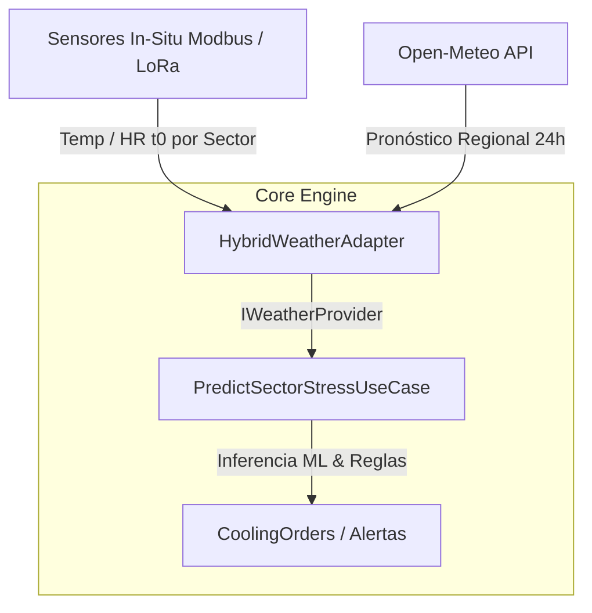

# SPIKE #17: Estrategia de Adquisición de Sensores Micro-Climáticos In-Situ vs Macro-Clima Open-Meteo API

**Estado:** Completado / Aprobado  
**Fecha:** Noviembre 2026  
**Proyecto:** AgroPredictTambo (Nestlé Conecta — AgroChallenge 2026)  
**Autor:** Subagente Arquitecto / IoT & Microclimate Specialist  

---

## 1. El Problema del "Domain Shift" Micro vs Macro
El motor predictivo de *AgroPredictTambo* se entrena y valida inicialmente con el feed meteorológico de **Open-Meteo API**. Sin embargo, las condiciones atmosféricas macro-climáticas a campo abierto (altura estándar de 2 metros, estación sin obstáculos) difieren drásticamente del micro-clima real en los diferentes sectores productivos del tambo:

1. **Corral de Espera:**
   - Densidad extrema de ganado (1 vaca por cada $1.5\text{ a }1.8\text{ m}^2$).
   - Carga térmica metabólica masiva: cada vaca en lactancia irradia entre $1000\text{ W}$ y $1400\text{ W}$ de calor sensible y exhala $0.8\text{ a }1.2\text{ kg/h}$ de vapor de agua.
   - Techo de chapa de zinc bajo: genera efecto de radiación infrarroja secundaria incrementando la temperatura de globo negro en hasta $+4.5\ ^\circ\text{C}$ respecto al campo abierto.
2. **Compost Barn:**
   - La cama orgánica de aserrín/cáscara de maní se encuentra en fermentación biológica aeróbica constante ($45\ ^\circ\text{C}\text{ a }60\ ^\circ\text{C}$ a $20\text{ cm}$ de profundidad).
   - Generación persistente de vapor ascendente y gases corrosivos: Amoníaco ($NH_3$), Metano ($CH_4$) y Dióxido de Carbono ($CO_2$).
   - La humedad relativa del aire sobre la cama suele ser entre un $8\%$ y un $18\%$ superior al exterior, mientras que la radiación solar directa es cero y el viento depende de la ventilación forzada.
3. **Peligro:** Si el modelo ML toma la temperatura y humedad externa de Open-Meteo en un día caluroso y húmedo, **subestimará el ITH real del galpón**, no activará el pre-enfriamiento ni los ventiladores a tiempo y se producirán caídas de producción y aumento de mastitis subclínica.

---

## 2. Matriz Comparativa Técnico-Económica de Tecnologías de Sensado

| Parámetro | Cableado RS-485 (Modbus RTU) | Inalámbrico LoRaWAN (868/915 MHz) | Inalámbrico WiFi / MQTT (ESP32) |
| :--- | :--- | :--- | :--- |
| **Costo por Nodo (Sensor + Carcasa)** | **Bajo:** USD 25 - USD 45 | **Medio-Alto:** USD 70 - USD 120 | **Muy Bajo:** USD 15 - USD 25 |
| **Costo de Pasarela / Concentrador** | USD 15 (USB-RS485 industrial aislado) | USD 180 - USD 350 (Gateway LoRa) | USD 30 (Access Point rural) |
| **Resistencia al Amoníaco ($NH_3$)** | **Excelente:** Sondas con filtro sinterizado de PTFE o acero inox 316L y electrónica en caja estanca remota. | **Media/Buena:** Requiere carcasas especiales IP67 con membrana transpirable Gore-Tex. | **Mala:** Los PCB expuestos con antenas integradas se sulfatan por condensación ácida en <6 meses. |
| **Inmunidad a Interferencias EMI** | **Máxima:** Par trenzado diferencial apantallado; inmune a variadores de frecuencia de ordeñadoras. | **Alta:** Excelente penetración en chapa mediante sub-GHz. | **Baja:** La estructura metálica del galpón crea una jaula de Faraday; pérdida frecuente de paquetes. |
| **Mantenimiento y Baterías** | **Cero:** Alimentación centralizada 12V/24V de tablero. | Requiere reemplazo de baterías de litio (LiSOCl2) cada 2 a 3 años. | Requiere fuentes conmutadas individuales o baterías recargables frecuentes. |
| **Latencia de Muestreo** | **Tiempo Real:** < 100 ms (Polling cíclico). | 5 a 15 minutos (por regulación de Duty Cycle). | 1 a 5 segundos. |

### Veredicto Técnico:
- **Sector Crítico Techado (Compost Barn y Corral de Espera):** **RS-485 / Modbus RTU industrial**. Es la solución más robusta y económica para ambientes con vapores de amoníaco y humedad saturante. Las sondas industriales estándar (ej. SHT40 o XY-MD02 con cápsula de sinterizado poroso) operan sin fallas durante años.
- **Sectores Abiertos y Comederos Distantes (> 100m):** **LoRaWAN (915 MHz)** para evitar zanjeo de cables hacia callejones o potreros lejanos.

---

## 3. Arquitectura de Fusión Híbrida: Sensor In-Situ ($t_0$) + Pronóstico Macro ($t_{+1h}..t_{+24h}$)

El desafío de ingeniería consiste en aprovechar la telemetría hiperlocal de los sensores en tiempo real sin perder la capacidad prospectiva a 24 horas que brinda Open-Meteo.



### Algoritmo de Calibración Dinámica (Delta Method / Bias Correction):
Para proyectar el micro-clima a 24 horas dentro del galpón, se calcula el diferencial térmico instantáneo en $t_0$:
$$\Delta T = T_{\text{in-situ}}(t_0) - T_{\text{macro}}(t_0)$$
$$\Delta HR = HR_{\text{in-situ}}(t_0) - HR_{\text{macro}}(t_0)$$

Para cada paso horario $t_k \in [t_{+1h}, \dots, t_{+24h}]$:
- Durante el día (radiación alta), el galpón mantiene una inercia térmica donde:
  $$T_{\text{micro}}(t_k) = T_{\text{macro}}(t_k) + \Delta T \cdot e^{-k/12}$$
  $$HR_{\text{micro}}(t_k) = \text{clamp}\left(HR_{\text{macro}}(t_k) + \Delta HR \cdot e^{-k/12},\ 10\%,\ 100\%\right)$$
- Esto permite ajustar suavemente el pronóstico regional hacia la realidad física del galpón sin descalibrar el horizonte lejano.

---

## 4. Evolución del Contrato y Adaptador Híbrido (PoC)

El puerto `IWeatherProvider` de dominio en `src/domain/ports/weather_provider_port.py` ya expone el contrato requerido:
```python
class IWeatherProvider(Protocol):
    def get_current_weather(self, latitude: float, longitude: float) -> WeatherConditions: ...
    def get_hourly_forecast(self, latitude: float, longitude: float, hours: int = 24) -> list[WeatherConditions]: ...
```

Se diseñó la PoC `HybridWeatherAdapter` en la capa de infraestructura (`src/infrastructure/weather_api/hybrid_weather_adapter.py`):
```python
class HybridWeatherAdapter(IWeatherProvider):
    """Fusiona lecturas locales Modbus con el pronóstico horario de Open-Meteo."""

    def __init__(
        self,
        local_sensor_reader: Callable[[], Optional[WeatherConditions]],
        macro_provider: IWeatherProvider,
    ) -> None:
        self._local_reader = local_sensor_reader
        self._macro = macro_provider

    def get_current_weather(self, lat: float, lon: float) -> WeatherConditions:
        local_cond = self._local_reader()
        if local_cond is not None:
            return local_cond  # Prioridad al dato in-situ de alta precisión
        return self._macro.get_current_weather(lat, lon)  # Fallback resiliente

    def get_hourly_forecast(self, lat: float, lon: float, hours: int = 24) -> list[WeatherConditions]:
        macro_fore = self._macro.get_hourly_forecast(lat, lon, hours)
        local_curr = self._local_reader()
        if not local_curr or not macro_fore:
            return macro_fore
        
        # Aplicación del Delta Method para calibrar el pronóstico regional
        delta_t = local_curr.temperature_c - macro_fore[0].temperature_c
        delta_hr = local_curr.relative_humidity - macro_fore[0].relative_humidity
        calibrated = []
        for i, cond in enumerate(macro_fore):
            weight = max(0.1, 1.0 - (i / hours))
            t_adj = round(cond.temperature_c + delta_t * weight, 1)
            hr_adj = round(min(100.0, max(10.0, cond.relative_humidity + delta_hr * weight)), 1)
            calibrated.append(WeatherConditions(t_adj, hr_adj, cond.wind_speed_kmh, cond.timestamp, cond.solar_radiation_wm2))
        return calibrated
```

### Cumplimiento Estricto de Clean Architecture:
- La capa `domain/` (`IWeatherProvider`, `WeatherConditions`, `THI_Score`) permanece **completamente intacta**.
- La capa `application/` (`PredictSectorStressUseCase`, `CalculateSavingsUseCase`) no sufre ninguna alteración: consume `IWeatherProvider` sin saber si los datos provienen de un satélite, una API web o una sonda Modbus por RS-485.

---

## 5. Conclusiones y Hoja de Ruta
1. **Sensado Recomendado:** Adquirir sondas industriales RS-485 Modbus con filtro sinterizado para Corral de Espera y Compost Barn.
2. **Resiliencia Operativa:** Si el cable RS-485 se corta o una sonda se daña, el adaptador conmuta automáticamente al macro-clima de Open-Meteo API sin interrumpir la operación del tambo.
3. **Calibración Auditada:** El reporte PDF de sustentabilidad registrará la fuente del dato (`"Sensor In-Situ #SB01"` o `"Open-Meteo API (Macro)"`) para máxima transparencia en auditorías de Nestlé.
