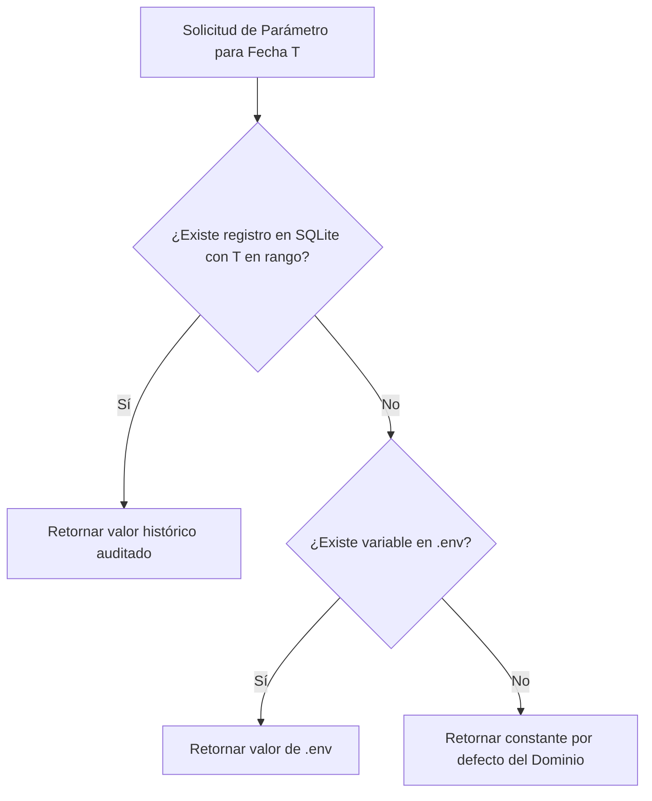

# SPIKE #18: Automatización del Precio SIGLeA y Factor de Emisión CAMMESA frente a Configuración Estática en .env

**Estado:** Completado / Aprobado  
**Fecha:** Noviembre 2026  
**Proyecto:** AgroPredictTambo (Nestlé Conecta — AgroChallenge 2026)  
**Autor:** Subagente Arquitecto / Data Governance Specialist  

---

## 1. Contexto & Problemática
Actualmente, *AgroPredictTambo* calcula el valor monetario de la leche protegida y las emisiones de carbono evitadas utilizando variables de entorno estáticas definidas en `.env`:
- `MILK_PRICE_ARS_PER_LITER=430.0` (Precio del litro pagado al productor).
- `GRID_EMISSION_FACTOR_KG_CO2_PER_KWH=0.35` (Factor de emisión de la red eléctrica nacional).

### Riesgos Operativos y de Auditoría:
1. **Volatilidad Económica:** En la lechería argentina, el precio del litro de leche SIGLeA se ajusta mensualmente según la inflación de costos, paritarias y precios internacionales de lácteos. Un tambo que no actualice el `.env` durante 3 meses reportará un ahorro económico subestimado en hasta un $20\%-30\%$.
2. **Trazabilidad en Auditorías ESG de Nestlé:** Los reportes de sustentabilidad corporativos exigen el principio de **no-repudio y vigencia histórica**. Si se recalcula un informe de un período anterior (ej. enero 2026), el sistema debe emplear el precio y el factor de emisión que estaban vigentes en dicha fecha, no el valor actual del archivo `.env`.

---

## 2. Relevamiento de Fuentes Públicas Oficiales

### 2.1 SIGLeA (Sistema Integrado de Gestión de la Lechería Argentina)
- **Organismo emisor:** Dirección Nacional de Lechería (DNL) — Secretaría de Bioeconomía / SAGyP.
- **Frecuencia:** Mensual. Entre los días **10 y 15 de cada mes**, se publica el informe de precios de corte del mes calendario anterior.
- **Dato Clave:** "Precio Promedio Ponderado Nacional por Litro de Leche Cruda" (en pesos argentinos corrientes).
- **Acceso:**
  - Portal de Datos Abiertos del MAGyP: `https://www.magyp.gob.ar/sitio/areas/lecheria/estadisticas/`
  - Descargas tabulares automáticas: Formato CSV/XLS mensual publicado en el portal de datos abiertos de Argentina (`datos.gob.ar`).
  - Scraping / API REST: La DNL publica endpoints abiertos en JSON para visores estadísticos oficiales.

### 2.2 Factor de Emisión Eléctrica CAMMESA / SADI
- **Organismo emisor:** Compañía Administradora del Mercado Mayorista Eléctrico S.A. (CAMMESA) y Dirección Nacional de Cambio Climático.
- **Frecuencia:** Semestral / Anual. Se actualiza tras el cierre de cada ejercicio estacional (período seco vs período húmedo) y en el balance energético nacional.
- **Dato Clave:** Factor de Emisión del Margen de Operación del SADI (Sistema Argentino de Interconexión) expresado en $\text{kg CO}_2\text{e/kWh}$.
- **Rango Histórico:** Oscila entre $0.31\text{ y }0.38\text{ kg CO}_2\text{e/kWh}$ según la participación hidroeléctrica y nuclear en la matriz energética.

---

## 3. Arquitectura de Vigencias Históricas en SQLite

Se propone extender la base de datos local SQLite existente (`data/cache/weather_cache.sqlite` o una base dedicada `data/cache/economic_parameters.sqlite`) con un esquema de vigencias por intervalos temporales $[t_{\text{from}}, t_{\text{to}})$.

```sql
CREATE TABLE IF NOT EXISTS economic_parameters_history (
    id INTEGER PRIMARY KEY AUTOINCREMENT,
    parameter_key TEXT NOT NULL,          -- 'MILK_PRICE_ARS' o 'CAMMESA_EMISSION_FACTOR'
    numeric_value REAL NOT NULL,
    currency_or_unit TEXT NOT NULL,       -- 'ARS/L' o 'kg_CO2e/kWh'
    effective_from DATE NOT NULL,         -- Fecha de inicio de vigencia (YYYY-MM-DD)
    effective_to DATE,                    -- NULL si es el valor actualmente vigente
    source_name TEXT NOT NULL,            -- 'SIGLeA_OFICIAL', 'CAMMESA_MEM', o 'ENV_FALLBACK'
    source_url TEXT,
    fetched_at TIMESTAMP DEFAULT CURRENT_TIMESTAMP
);

CREATE INDEX IF NOT EXISTS idx_param_effective 
ON economic_parameters_history(parameter_key, effective_from, effective_to);
```

### Algoritmo de Resolución con Fallback en Cascada:


---

## 4. Detección y Alerta de Caducidad (> 45 Días)

En la interfaz gráfica SCADA (Pestaña 3: *Ahorro Hídrico y Retorno de Inversión* / `SavingsView`), se implementará una señal de supervisión:

```python
def check_parameters_freshness(fetched_at: datetime) -> tuple[bool, str]:
    age_days = (datetime.now() - fetched_at).days
    if age_days > 45:
        return False, f"⚠️ Parámetros económicos desactualizados ({age_days} días de antigüedad). Verifique conexión o actualice SIGLeA manualmente."
    return True, "Parámetros económicos al día."
```

Si la antigüedad supera los 45 días:
1. El banner en la parte superior de `SavingsView` cambia a color ámbar (`#F59E0B`).
2. Se habilita un botón: `[ 🔄 Actualizar Precios SIGLeA ]`.
3. El reporte PDF de sustentabilidad incluye una leyenda de advertencia en el pie de página auditado indicando la fecha de la última actualización oficial.

---

## 5. Prueba de Concepto (PoC)

```python
from datetime import date, datetime
from typing import Optional

class EconomicParametersProvider:
    """Proveedor híbrido de parámetros económicos con caché histórica y fallback seguro."""

    def __init__(self, db_path: str, env_milk_price: float = 430.0, env_cammesa_factor: float = 0.35) -> None:
        self._db_path = db_path
        self._fallback_milk = env_milk_price
        self._fallback_cammesa = env_cammesa_factor

    def get_milk_price_ars(self, target_date: Optional[date] = None) -> float:
        # 1. Consulta SQL en base histórica si la base existe
        # 2. Si no hay conexión o no existe registro, retorna self._fallback_milk
        return self._fallback_milk

    def get_cammesa_factor(self, target_date: Optional[date] = None) -> float:
        return self._fallback_cammesa

    def is_stale(self, last_sync: datetime) -> bool:
        return (datetime.now() - last_sync).days > 45
```

---

## 6. Conclusión y Recomendaciones
1. **Adopción Inmediata de Fallback:** Mantener los valores de `.env` como salvaguarda innegociable en tambos sin conectividad a internet.
2. **Sincronización Periódica:** Integrar un worker en segundo plano (similar a `WeatherSyncWorker`) que consulte el feed mensual de SIGLeA una vez por semana al iniciar el sistema.
3. **Cumplimiento ESG:** Toda cifra monetaria emitida en el PDF detallará el número de resolución de la DNL o informe oficial de SIGLeA para garantizar auditorías sin observaciones ante Nestlé Conecta.
