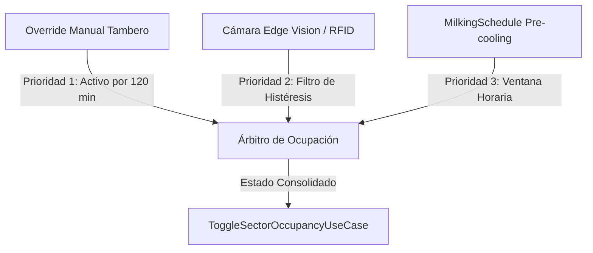

# SPIKE #19: Detección Automática de Ocupación de Sectores frente a Toggle Manual y Agenda Fija MilkingSchedule

**Estado:** Completado / Aprobado  
**Fecha:** Noviembre 2026  
**Proyecto:** AgroPredictTambo (Nestlé Conecta — AgroChallenge 2026)  
**Autor:** Subagente Arquitecto / Computer Vision & Sensing Specialist  

---

## 1. Problemática Operativa del Tambo
En el modelo actual de *AgroPredictTambo*, la presencia de animales en cada sector depende de dos mecanismos:
1. **Toggle Manual:** El operario hace clic en la tarjeta SCADA o envía el comando `/ocupar <sector_id> <true/false>` vía Telegram.
2. **Agenda Fija (`MilkingSchedule`):** Activa el pre-enfriamiento preventivo en corral de espera durante los turnos habituales (mañana: 04:00 - 07:00, tarde: 16:00 - 19:00).

### Desafíos en Producción:
- **Olvidos del Personal:** Si el operario olvida desocupar el sector al terminar el ordeñe, los aspersores continúan disparando micro-ciclos innecesarios, inundando el corral y consumiendo agua y electricidad.
- **Variabilidad de la Rutina:** Por contingencias climáticas (barro, rotura de tractor en mixer, retraso en bajadas de ordeñe), el arreo de los lotes puede adelantarse o atrasarse hasta $60\text{ minutos}$, desalineando la agenda fija `MilkingSchedule`.

---

## 2. Matriz Comparativa de Tecnologías de Detección Automática

| Tecnología | Principio de Funcionamiento | Costo Estimado | Mantenimiento Rural | Precisión en Entorno Tambo | Viabilidad AgroPredict 2026 |
| :--- | :--- | :--- | :--- | :--- | :--- |
| **Barreras Infrarrojas (Haz Óptico)** | Sensores fotoeléctricos emisor-receptor en las tranqueras de acceso. Cuenta entradas y salidas netas. | **Bajo:** USD 80 - USD 140 por tranquera. | **Muy Alto:** El polvo de callejón, el barro salpicado por pezuñas y el telar de arañas bloquean los lentes semanalmente. | **Baja:** Si dos vacas cruzan juntas o una vaca retrocede a mitad de manga, el conteo incremental se desincroniza. | ❌ Descartada por mantenimiento excesivo en barro. |
| **Cámaras Edge con Visión Artificial** | Cámara IP RTSP sobre corral + microprocesador edge (ej. Raspberry Pi 5 / Coral Edge TPU con modelo YOLOv8-Nano cuantizado a INT8). | **Medio:** USD 150 - USD 220 por sector. | **Bajo:** Limpieza mensual de domo de cámara. No tiene componentes mecánicos ni cables al alcance de los animales. | **Muy Alta:** Detección directa de bounding boxes de ganado. Evalúa tanto presencia binaria como densidad y aglomeración. | ✅ **Recomendada (Visión Directa)**. |
| **Integración RFID con Software de Ordeñe** | Lectura de caravanas electrónicas (HDX/FDX-B) en la entrada de la sala de ordeñe (DeLaval DelPro, GEA CowScout, Lely T4C). | **Muy Bajo (Marginal):** USD 0 en hardware si el tambo ya posee bretes de lectura; solo requiere driver de integración API/RS-232. | **Cero:** Sistema comercial ya mantenido por el servicio técnico del fabricante de ordeñadoras. | **Máxima:** Sabe con exactitud cuándo el lote comenzó a ser ordeñado y cuándo cruzó la última vaca del lote. | ✅ **Recomendada (Fusión de Datos)**. |

---

## 3. Jerarquía de Prioridad e Histéresis Temporal

Para evitar falsos positivos (ej. una vaca aislada que cruza comederos por 10 segundos) o cortes abruptos (un lote que se mueve hacia un rincón del corral), se define una **máquina de arbitraje con histéresis**:



### Reglas de Dominio:
1. **Prioridad 1 (Override Manual del Operario):**
   - Si el tambero ejecuta `/ocupar <id> false` manualmente (por tareas de limpieza, inseminación o raspado de bosta), el sector se bloquea en `False` durante un temporizador de **120 minutos**, ignorando sensores automáticos.
2. **Prioridad 2 (Sensor Automático con Histéresis):**
   - **Transición a OCUPADO (`False` $\to$ `True`):** Requiere detección de al menos 3 animales durante más de **30 segundos continuos**.
   - **Transición a LIBRE (`True` $\to$ `False`):** Requiere **0 animales detectados durante 3 minutos consecutivos**. Esto evita apagar aspersores si las vacas se agrupan momentáneamente en el fondo del corral fuera del campo visual principal.
3. **Prioridad 3 (Pre-enfriamiento `MilkingSchedule`):**
   - Si no hay override manual, `MilkingSchedule` puede encender el corral 20 minutos antes del turno si el ITH proyectado supera el umbral de peligro, enfriando la losa de cemento antes del ingreso de los animales.

---

## 4. PoC de Puerto de Sensado Hexagonal (`IOccupancySensor`)

Siguiendo Clean Architecture, se define el contrato hexagonal sin atarse a ninguna marca de cámara o RFID:

```python
from typing import Protocol

class IOccupancySensor(Protocol):
    """Puerto para detección telemétrica de ganado por visión artificial o RFID."""
    def is_sector_occupied(self, sector_id: str) -> bool: ...
    def get_animal_count(self, sector_id: str) -> int: ...
```

### Adaptador de Integración y Dispatcher al Caso de Uso:
```python
class EdgeCameraOccupancyAdapter(IOccupancySensor):
    """Driver que procesa inferencias RTSP de YOLOv8-Nano y dispara eventos."""

    def __init__(self, toggle_uc: ToggleSectorOccupancyUseCase) -> None:
        self._toggle_uc = toggle_uc
        self._consecutive_empty_seconds: dict[str, int] = {}

    def on_vision_inference(self, sector_id: str, cows_detected: int) -> None:
        if cows_detected >= 3:
            self._consecutive_empty_seconds[sector_id] = 0
            self._toggle_uc.execute(sector_id, True)
        elif cows_detected == 0:
            self._consecutive_empty_seconds[sector_id] = self._consecutive_empty_seconds.get(sector_id, 0) + 10
            # Histéresis de 180 segundos (3 minutos)
            if self._consecutive_empty_seconds[sector_id] >= 180:
                self._toggle_uc.execute(sector_id, False)
```

---

## 5. Conclusiones y Hoja de Ruta
1. **Fase Inmediata (MVP 3):** Mantener el toggle manual y la agenda `MilkingSchedule` como base estable ya implementada en el SCADA y Bot de Telegram.
2. **Evolución Comercial (Fase 13+):** Implementar el adaptador de visión artificial `EdgeCameraOccupancyAdapter` utilizando cámaras domo estándar sobre corral de espera y comederos, reduciendo a cero el factor de error humano en el consumo hídrico.
