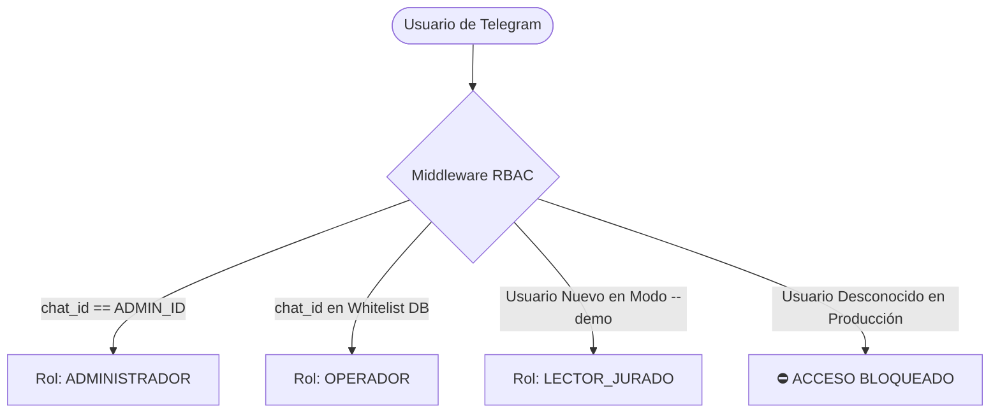

# SPIKE #21: Seguridad de Acceso al Bot de Telegram (Whitelist de chat_id, Roles y Auditoría de Comandos)

**Estado:** Completado / Aprobado  
**Fecha:** Noviembre 2026  
**Proyecto:** AgroPredictTambo (Nestlé Conecta — AgroChallenge 2026)  
**Autor:** Subagente Arquitecto / Cyber-Physical Security Specialist  

---

## 1. Contexto & Vector de Amenaza Ciberfísica
El bot oficial de Telegram de *AgroPredictTambo* cumple una doble función estratégica:
1. **Canal Operativo:** Notifica alertas en tiempo real a los tamberos y permite registrar la presencia de lotes mediante el comando `/ocupar <sector_id> <true/false>`, el cual activa electroválvulas y ventiladores industriales.
2. **Canal de Demostración para el Pitch:** Exhibe un código QR interactivo generado automáticamente (`data/cache/bot_qr.png`) para que el jurado de Nestlé Conecta interactúe en vivo desde sus propios celulares durante la presentación.

### La Vulnerabilidad en Producción:
Telegram es una plataforma pública global. Si el enlace del bot o el QR trasciende a personas ajenas al tambo, un atacante remoto podría enviar comandos `/ocupar` de forma maliciosa o descuidada:
- Apagar el enfriamiento de 120 vacas en pleno pico de calor extremo (provocando colapsos térmicos o muerte súbita).
- Encender aspersores en corrales vacíos de forma continua, inundando callejones de bosta y malgastando miles de litros de agua auditada.

Por tanto, es mandatorio desacoplar la **demostración pública** de la **operación real de producción** mediante un modelo estricto de Control de Acceso Basado en Roles (RBAC).

---

## 2. Modelo de Autorización RBAC y Roles

Se definen tres niveles de privilegio:



### Matriz de Permisos por Rol:

| Comando | Acción Operativa | `ADMIN` | `OPERADOR` | `LECTOR_JURADO` (Modo Demo) | Anónimo (Prod) |
| :--- | :--- | :---: | :---: | :---: | :---: |
| `/start`, `/help` | Menú principal y ayuda contextual. | ✅ | ✅ | ✅ | ❌ |
| `/estado` | Telemetría climática actual e ITH. | ✅ | ✅ | ✅ | ❌ |
| `/pronostico` | Curva horaria y horas críticas a 24h. | ✅ | ✅ | ✅ | ❌ |
| `/sectores` | Estado y ocupación de los 3 sectores. | ✅ | ✅ | ✅ | ❌ |
| `/prediccion` | Inferencia ML y órdenes de mitigación. | ✅ | ✅ | ✅ | ❌ |
| `/ahorro` | Métricas de agua, kWh y leche SIGLeA. | ✅ | ✅ | ✅ | ❌ |
| `/reporte` | Envío del informe PDF de sustentabilidad. | ✅ | ✅ | ✅ | ❌ |
| `/ocupar` | **Actuación física sobre relés.** | ✅ | ✅ | ⚠️ Solo Virtual / Deshabilitado | ❌ |
| `/vincular` | Enrolamiento de operarios con PIN. | ✅ | ✅ | ❌ | ❌ |
| `/admin` | Gestión de whitelist y auditoría. | ✅ | ❌ | ❌ | ❌ |

### Modo Explícito para Pitch (`--demo-public-qr`):
Al iniciar la aplicación con la bandera `--demo-public-qr`:
1. El bot asigna automáticamente el rol `LECTOR_JURADO` a cualquier nuevo `chat_id` que inicie conversación escaneando el QR.
2. Si un jurado envía `/ocupar comederos true`, el bot simula la respuesta en el chat para fines pedagógicos pero **bloquea la orden física al hardware de relés**, informando:
   `"ℹ️ [Modo Demo]: Simulación aceptada en pantalla. El hardware de potencia no se activa por seguridad animal."`

---

## 3. Flujo de Enrolamiento Seguro de Operarios

Para agregar peones o veterinarios autorizados sin editar manualmente el archivo `.env`, se diseñan dos mecanismos:

### Método A: PIN Temporal de Emparejamiento en Pantalla SCADA (Recomendado)
1. En la PC de sala de leche, el tambero presiona el botón `[ 🔑 Generar PIN de Operador ]` en la pestaña de configuración.
2. La pantalla genera un código criptográficamente aleatorio de 6 dígitos con validez de 10 minutos (ej. `PIN: 739201`).
3. El operario abre Telegram en su celular y envía `/vincular 739201`.
4. El sistema valida el PIN, asocia su `chat_id` y nombre de usuario en la base SQLite local con rol `OPERADOR`, y notifica:
   `"✅ Vinculación exitosa. Hola Martín, has sido habilitado como OPERADOR de Tambo San José."`

### Método B: Aprobación Push por Administrador
Si un operario escribe al bot sin PIN:
1. El bot le responde: *"Tu solicitud de acceso está pendiente de aprobación."*
2. El bot envía un mensaje privado con botones inline al `TELEGRAM_ADMIN_CHAT_ID`:
   `"⚠️ Solicitud de acceso: @marcos_campo (ID: 84910284). ¿Aprobar como Operador?"`
   `[ ✅ Aceptar ]  [ ❌ Rechazar ]`
3. Al tocar "Aceptar", el middleware actualiza la whitelist inmediatamente.

---

## 4. Middleware de Seguridad y Auditoría de Comandos

### 4.1 Esquema de Auditoría en SQLite (`telegram_security.sqlite`)
```sql
CREATE TABLE IF NOT EXISTS authorized_users (
    chat_id INTEGER PRIMARY KEY,
    username TEXT,
    full_name TEXT,
    role TEXT NOT NULL CHECK (role IN ('ADMIN', 'OPERADOR', 'LECTOR_JURADO')),
    enrolled_at TIMESTAMP DEFAULT CURRENT_TIMESTAMP,
    is_active INTEGER DEFAULT 1
);

CREATE TABLE IF NOT EXISTS command_audit_log (
    id INTEGER PRIMARY KEY AUTOINCREMENT,
    chat_id INTEGER NOT NULL,
    username TEXT,
    command_text TEXT NOT NULL,
    role_at_execution TEXT NOT NULL,
    authorized INTEGER NOT NULL,         -- 1: Permitido, 0: Denegado
    executed_at TIMESTAMP DEFAULT CURRENT_TIMESTAMP
);
```

### 4.2 PoC del Decorador / Interceptor de Autorización:
```python
from enum import Enum
from functools import wraps
from typing import Any, Callable

class Role(str, Enum):
    ADMIN = "ADMIN"
    OPERADOR = "OPERADOR"
    LECTOR_JURADO = "LECTOR_JURADO"

def require_role(min_role: Role, is_demo_mode: bool = False) -> Callable[..., Any]:
    """Middleware que verifica permisos antes de despachar un handler de Telegram."""
    def decorator(func: Callable[..., Any]) -> Callable[..., Any]:
        @wraps(func)
        def wrapper(update: Any, context: Any, *args: Any, **kwargs: Any) -> Any:
            chat_id = update.effective_chat.id
            user_role = resolve_user_role(chat_id, is_demo_mode)
            
            # Matriz de jerarquía
            hierarchy = {Role.LECTOR_JURADO: 1, Role.OPERADOR: 2, Role.ADMIN: 3}
            if hierarchy.get(user_role, 0) < hierarchy.get(min_role, 0):
                log_audit(chat_id, update.message.text, user_role, authorized=False)
                update.message.reply_text("⛔ Acceso denegado: Este comando requiere mayores privilegios.")
                return None
            
            log_audit(chat_id, update.message.text, user_role, authorized=True)
            return func(update, context, *args, **kwargs)
        return wrapper
    return decorator
```

---

## 5. Conclusión y Recomendaciones
1. **Blindaje Ciberfísico Completo:** La separación entre modo demo (`--demo-public-qr`) y modo producción garantiza que el pitch de Nestlé sea dinámico e interactivo sin arriesgar la infraestructura del tambo.
2. **Trazabilidad Total (Auditoría):** Cada comando `/ocupar` queda registrado con marca de tiempo, usuario y rol, cumpliendo con los estándares de control interno y auditoría formal de Nestlé Conecta.
